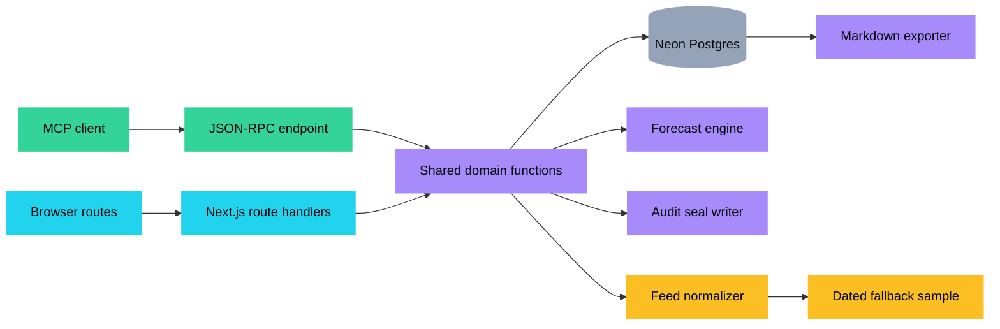
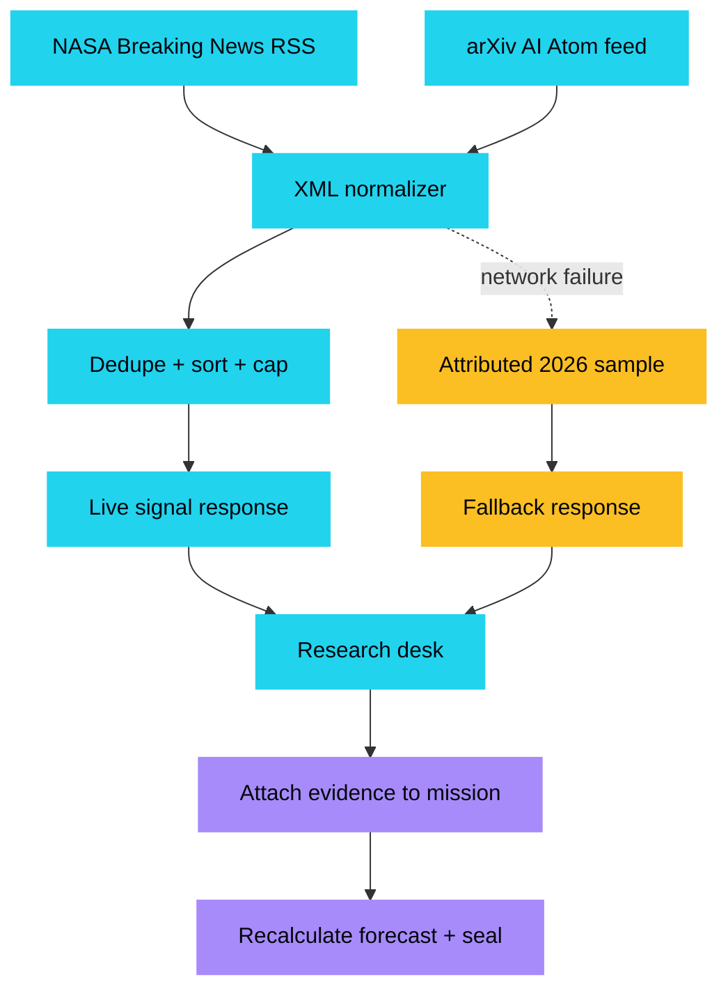
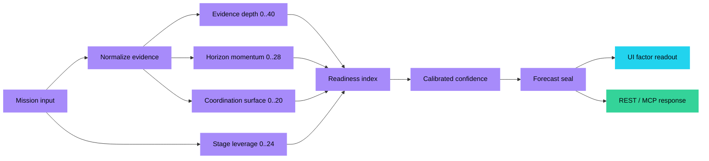
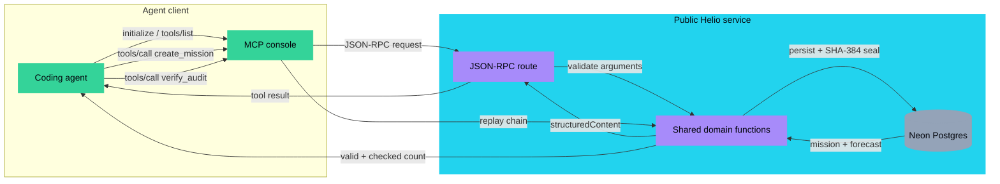
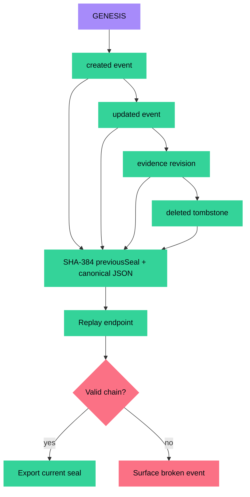
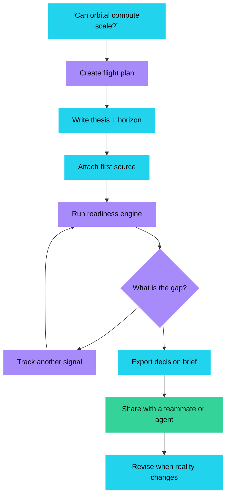
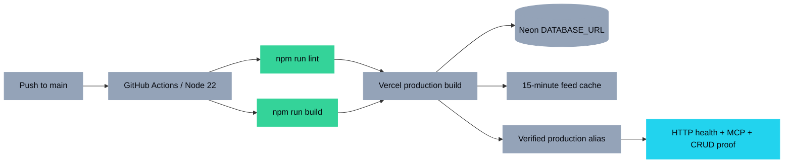
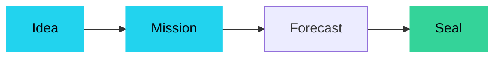
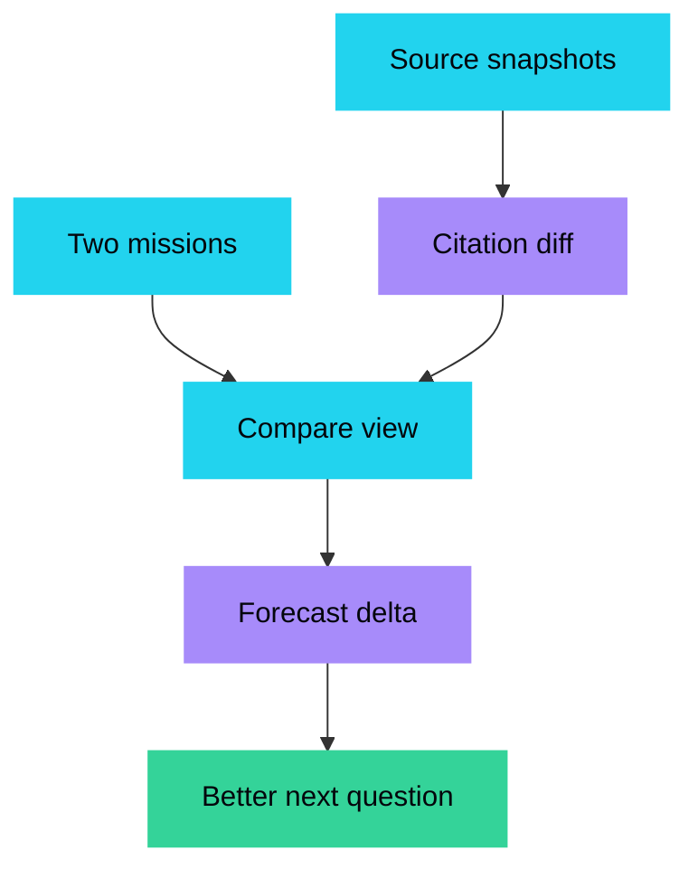
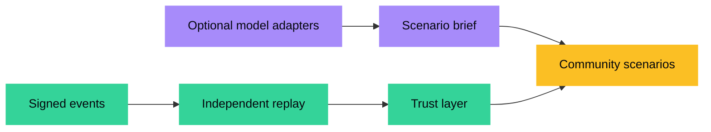

<div align="center">

# HELIO COMMONS

### Map the next compute frontier.

[](https://helio-commons.vercel.app)
[](https://nextjs.org)
[](https://www.typescriptlang.org)
[](LICENSE)
[](#-live-data-layer)
[](#-agent-interface)

[Live App](https://helio-commons.vercel.app) · [API health](https://helio-commons.vercel.app/api/health) · [MCP manifest](https://helio-commons.vercel.app/mcp.json) · [Issues](https://github.com/aniruddhaadak80/helio-commons/issues)

</div>

Helio Commons is a playable, evidence-first fieldbook for **space data centers, Project Suncatcher, AI capability scenarios, and the long road toward superintelligence**. It turns a research headline into a persisted flight plan, runs one explainable readiness engine, and leaves a replayable SHA-384 audit trail.

The demo is intentionally useful without an account or an API key: a user can create a mission, attach evidence, run a forecast, track a live research signal, export a brief, and let an MCP-compatible agent do the same through JSON-RPC.

> **Positioning:** This is a planning aid for exploring assumptions. It is not a scientific forecast, investment recommendation, launch authorization, or safety certification.

## ✨ Features

- **Persistent mission CRUD** — create, read, update, retire, and replay mission cards through Next.js route handlers.
- **Explainable readiness engine** — evidence depth, horizon momentum, stage leverage, and coordination surface are itemized in every readout.
- **Live research desk** — NASA Breaking News and arXiv AI feeds are normalized into one signal type, cached for 15 minutes, and backed by an attributed offline sample.
- **Agent interface** — JSON-RPC `initialize`, `tools/list`, and `tools/call`, including mutating `create_mission` and `update_mission` tools.
- **Integrity story** — every mutation appends `SHA-384(previousSeal ‖ canonicalJson(event))`; the verification route replays the chain.
- **Decision export** — download a mission as a shareable Markdown brief with the current forecast and seal.
- **Fresh visual identity** — a cobalt/amber launch-board schematic with animated telemetry, deliberately unlike a globe, dark-glass dashboard, or ticker template.
- **No-account core** — the board is shared and public by design; auth is intentionally omitted because the first useful loop is research exploration, not private workspace ownership.

## 🗺️ Product map

| Surface | What it does | Live API |
| --- | --- | --- |
| `/` | Landing page and product thesis | — |
| `/board` | Create, list, and retire mission cards | `GET/POST /api/missions` |
| `/mission/[id]` | Edit a flight plan, attach evidence, replay forecast, verify audit, export brief | `GET/PATCH/DELETE /api/missions/[id]` |
| `/signals` | Read live/fallback research and attach a signal to a mission | `GET /api/feed` |
| `/console` | Discover and call MCP-style tools from the browser | `POST /api/mcp` |
| `/method` | Explain the engine and safety scope | — |
| `/api/health` | Storage mode, mission count, and audit health | `GET /api/health` |
| `/api/forecast` | Run the deterministic engine and return a forecast seal | `POST /api/forecast` |
| `/api/audit/verify` | Replay the full or mission-scoped chain | `GET /api/audit/verify` |
| `/api/export` | Download a mission brief | `GET /api/export?missionId=…` |

## 🚀 Quickstart

```bash
git clone https://github.com/aniruddhaadak80/helio-commons.git
cd helio-commons
npm install
npm run dev
```

Open `http://localhost:3000`. The local experience needs no environment variables. Without `DATABASE_URL`, the app uses a seeded process-local store so the UI and API can be explored immediately. Production uses Neon Postgres; configure it with:

```bash
# Vercel production environment variable
DATABASE_URL=postgresql://...
```

The schema is in [`db/schema.sql`](db/schema.sql). The app seeds its first three mission cards on an empty database and uses soft-delete tombstones so retired cards still participate in audit replay.

## 🧭 System architecture



The important boundary is the **shared domain layer**: REST handlers, MCP tools, the UI actions, and exports do not maintain separate copies of the forecast or persistence rules.

## 📡 Live data layer



The feed route uses `revalidate = 900`. If both public feeds are unavailable, the app still returns dated signals from Google Research, Google DeepMind, GAO, AI 2027, and AI 2040 so the first paint and demo remain useful. The feed is research input, not an endorsement of any forecast.

## 🧮 Forecast engine



The same `calculateForecast` function serves the board, `/api/forecast`, and the MCP `run_forecast` tool. The current reference year is `2026`; the factors are intentionally simple so a reader can challenge them.

- **Evidence depth:** source count, verified count, and source-kind diversity.
- **Horizon momentum:** how close the target year is to the reference year.
- **Stage leverage:** watch, prototype, or deploy.
- **Coordination surface:** diversity of evidence and presence of policy context.
- **Confidence:** evidence quality adjusted for horizon distance and the user’s prior confidence.

## 🤖 Agent interface



Available tools:

| Tool | Mutates? | Purpose |
| --- | --- | --- |
| `list_missions` | no | Read active mission cards |
| `create_mission` | **yes** | Create and seal a mission |
| `update_mission` | **yes** | Patch fields/evidence and seal a revision |
| `run_forecast` | no | Run the shared engine and return a forecast seal |
| `verify_audit` | no | Replay the chain |
| `export_mission` | no | Render a Markdown brief |

### MCP client setup

```json
{
  "mcpServers": {
    "helio-commons": {
      "type": "http",
      "url": "https://helio-commons.vercel.app/api/mcp"
    }
  }
}
```

The in-page console at [`/console`](https://helio-commons.vercel.app/console) proves the same endpoint with one-click `initialize`, `tools/list`, and a real mutating `create_mission` call.

## 🔐 Integrity and audit chain



The mission row stores the current `prevSeal` and `seal`; the audit table stores the full event data and monotonic sequence. `GET /api/audit/verify` recomputes the chain and reports the number of checked events.

## 🛰️ User journey



The three usefulness jobs are:

1. A user can create/edit/delete a mission card so a research bet has an actionable home.
2. A user can add evidence and run the deterministic engine so they can see which constraint deserves attention.
3. A user can read live research, attach it, export a brief, or call the MCP tool so current research becomes a shareable next step.

## 🔌 API

### Health

```bash
curl https://helio-commons.vercel.app/api/health
```

### Create → read back

```bash
curl -X POST https://helio-commons.vercel.app/api/missions \
  -H 'content-type: application/json' \
  -d '{
    "name": "Optical fabric beats radio",
    "thesis": "Does short-range free-space optical linking unlock clustered orbital inference?",
    "category": "space-compute",
    "stage": "watch",
    "horizonYear": 2030,
    "confidence": 64,
    "evidence": []
  }'
```

Copy the returned `mission.id`, then read it back:

```bash
curl https://helio-commons.vercel.app/api/missions/<mission-id>
```

### Update and forecast

```bash
curl -X PATCH https://helio-commons.vercel.app/api/missions/<mission-id> \
  -H 'content-type: application/json' \
  -d '{"stage":"prototype","evidence":[{"title":"A new test result","source":"Lab note","url":"https://example.com","kind":"primary","date":"2026-09-25","verified":true}]}'

curl -X POST https://helio-commons.vercel.app/api/forecast \
  -H 'content-type: application/json' \
  -d '{"missionId":"<mission-id>"}'
```

### Verify and export

```bash
curl 'https://helio-commons.vercel.app/api/audit/verify?missionId=<mission-id>'
curl 'https://helio-commons.vercel.app/api/export?missionId=<mission-id>'
```

## 🚀 Deployment pipeline



## 🗺️ Roadmap

### Now · Make the bet useful

- [x] **Outcome:** a user can create a mission and get an immediate, explainable readiness readout.
- [x] **Outcome:** evidence can be added, revised, and verified through a sealed chain.
- [x] **Outcome:** a live signal can become a persisted evidence item.
- [x] **Outcome:** an agent can discover and mutate the same domain through MCP.



### Next · Make the board collaborative

- [ ] Add lightweight signed identities or GitHub sign-in when a contributor needs ownership.
- [ ] Add source snapshots and citation diffs so a claim can be compared across time.
- [ ] Add a compare view for two missions and a “what changed” forecast delta.
- [ ] Add a scheduled source-health view for feed freshness and fallback frequency.



### Later · Open research protocol

- [ ] Publish a signed event stream for independent replay.
- [ ] Add optional user-supplied model adapters for qualitative synthesis while keeping the deterministic engine primary.
- [ ] Add scenario packs for AI 2027 / AI 2040 with explicit assumptions and sensitivity ranges.
- [ ] Submit the MCP endpoint to agent directories and publish reproducible research briefs.



## 📚 Sources and attribution

- [Google Research — Project Suncatcher](https://blog.google/innovation-and-ai/technology/research/google-project-suncatcher/)
- [Google DeepMind — From AGI to ASI](https://deepmind.google/research/publications/239142/)
- [U.S. GAO — Data Centers in Space](https://www.gao.gov/products/gao-26-109012)
- [AI 2027 — Takeoff Forecast](https://ai-2027.com/research/takeoff-forecast)
- [AI 2040 — Plan A](https://ai-2040.com/)
- NASA Breaking News RSS and arXiv AI Atom feed for live signal ingestion.

Feed titles and summaries remain attributed to their publishers. Helio Commons does not claim that a source’s forecast is correct.

## 📁 Repository map

```text
src/app/                 App Router pages, API routes, metadata, and loading/error states
src/components/          Nav, telemetry scene, board, detail, signals, and MCP console
src/lib/types.ts         Shared domain and normalized feed types
src/lib/engine.ts        Deterministic readiness engine
src/lib/db.ts            Neon + local persistence adapter and audit replay
src/lib/feed.ts          RSS/Atom normalization with dated fallback
src/lib/canonical.ts     Canonical JSON and SHA-384 sealing
src/lib/brief.ts         Markdown export renderer
src/lib/validation.ts    Shared REST/MCP input validation
db/schema.sql            Neon schema
public/mcp.json          Agent manifest
.github/workflows/ci.yml Node 22 lint/build workflow
```

## ⚠️ Safety and scope

This repository is adjacent to space infrastructure, AI capability forecasting, and governance. Do not use a Helio Commons readout to authorize a launch, certify hardware, make an investment decision, or predict a species-level future. The app is an explainable planning surface; real engineering, scientific review, legal review, and safety assessment remain human responsibilities.

## 🤝 Contributing

Read [CONTRIBUTING.md](CONTRIBUTING.md), open an issue before large changes, and keep the deterministic engine and its factor readout covered by a reproducible example. See [SECURITY.md](SECURITY.md) before reporting a vulnerability.

## 📄 License

MIT © 2026 Aniruddha Adak. See [LICENSE](LICENSE).
